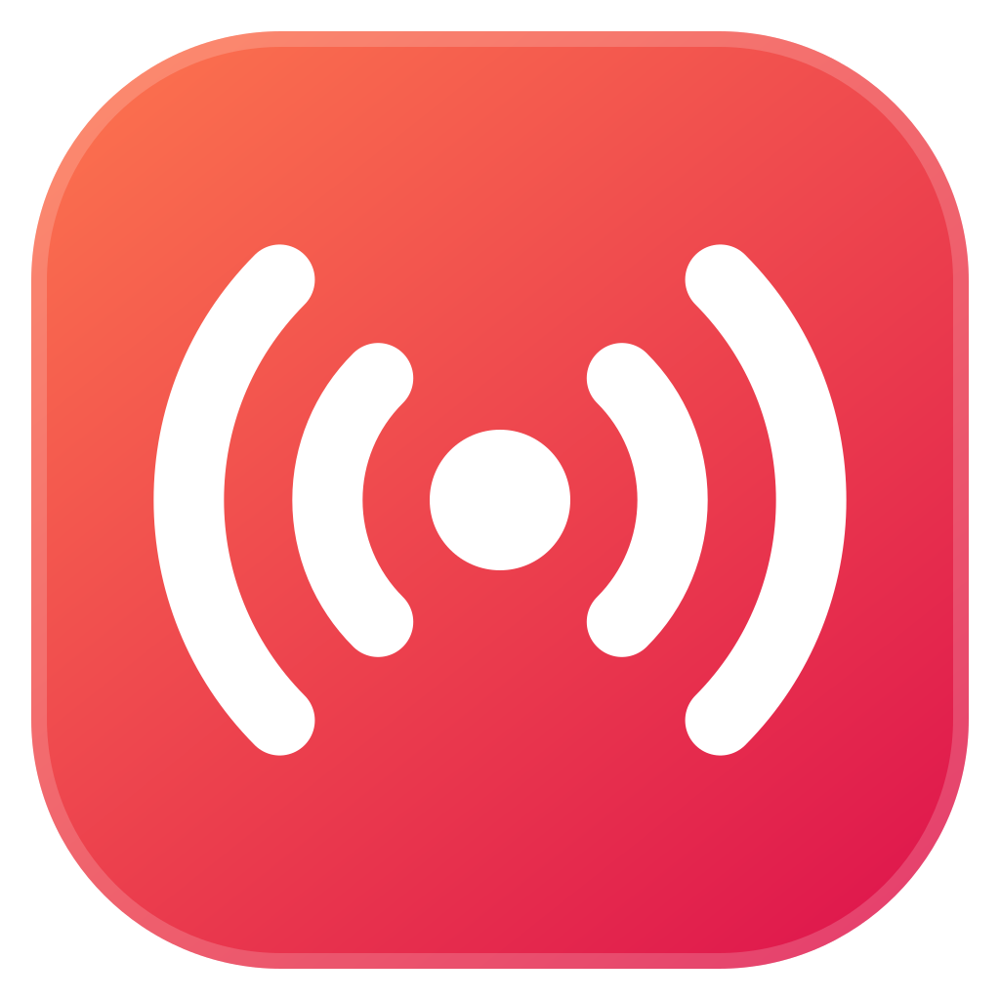
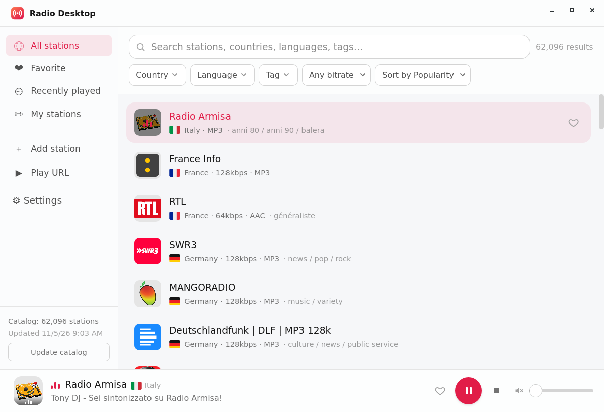
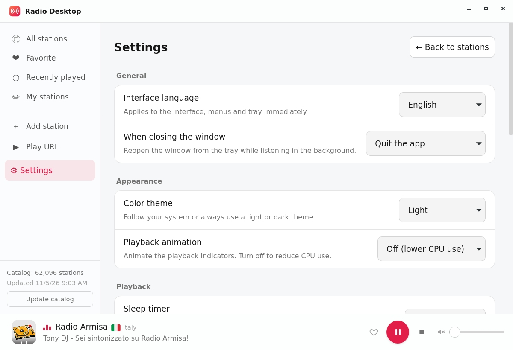
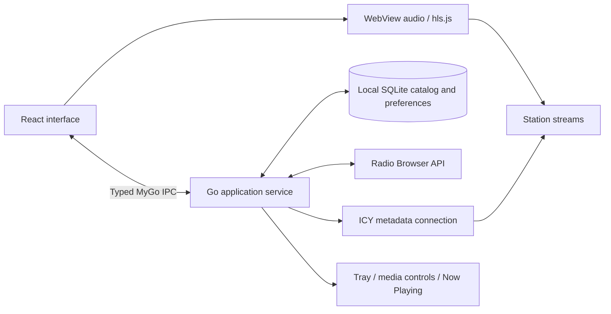

<p align="center">
  
</p>
<h1 align="center">Radio Desktop</h1>
<p align="center">Internet radio, at home on your desktop.</p>
<p align="center">
  <a href="LICENSE"></a>
  
  
</p>
<p align="center">English · <a href="README.zh-CN.md">简体中文</a></p>

Browse stations around the world, find a favorite, and keep listening from the system tray. Radio Desktop is the GUI sibling of [radio-cli](https://github.com/hmgle/radio-cli), built with Go, React, and [MyGo](https://github.com/egoist/mygo). It uses your system WebView for audio: no external player, mpv, or FFmpeg installation is required for everyday listening.



## Features

- **A local radio catalog.** Search the [Radio Browser](https://www.radio-browser.info/) directory by station name, country, language, or tag. Filter by bitrate and sort by popularity, votes, name, bitrate, or randomly. A small initial catalog is followed by a full background sync.
- **Your own collection.** Favorites, recently played stations, custom stations, and quick playback of a stream URL.
- **Live track information.** ICY titles and artwork when supplied by the broadcaster, plus an expanded station details view.
- **Desktop controls.** System tray, media play/pause keys, and Now Playing integration where supported by the OS and desktop environment.
- **Comfortable listening.** Volume memory, playback fades, startup restore options, and a sleep timer.
- **Make it yours.** English and Simplified Chinese, light/dark/system themes, keyboard navigation, and optional playback animations.

MP3, AAC, and HLS playback depends on the system WebView and installed codecs. HLS uses native support when available, with bundled hls.js as a fallback. Some stations may be unavailable or restricted in your region.

<details>
<summary>Settings</summary>



Screenshots show the Linux desktop application; native controls vary by platform. See [screenshot notes](docs/images/README.md).
</details>

## Get started

Download a package for your platform from [GitHub Releases](https://github.com/hmgle/radio-desktop/releases/latest). macOS packages are unsigned disk images; Linux packages include a `.deb` and a tarball with an installer; Windows x64 packages are unsigned `.exe` installers. To build from source, follow the steps below.

Windows x64 builds are available through the manually run **Desktop packages** workflow in [GitHub Actions](https://github.com/hmgle/radio-desktop/actions/workflows/packages.yml). Download and extract the Windows artifact, then run `radio-desktop-setup-<version>-amd64.exe`. Windows GUI playback and installation still need validation on a real machine.

Build from source using **Go 1.27.3 or newer** and **Bun 1.4.2** (the version used in CI):

```sh
bun install --frozen-lockfile
bun run dev
```

Windows requires the [Microsoft Edge WebView2 Runtime](https://developer.microsoft.com/microsoft-edge/webview2/); install the Evergreen Runtime if it is missing. The app installer does not bundle it.

Run these commands from a checkout of this repository. On macOS, install Xcode Command Line Tools (`xcode-select --install`). On Linux, install the runtime libraries first:

```sh
# Debian / Ubuntu
sudo apt install libwebkit2gtk-4.1-0 libgtk-3-0 libpulse0
# Fedora
sudo dnf install webkit2gtk4.1 gtk3 pulseaudio-libs
```

To produce a desktop package:

```sh
bun run build
```

Output goes into `build/<platform>-<architecture>/`. macOS builds produce an `.app` and `.dmg`; Linux builds produce an executable, `.deb`, and a tarball with `install.sh`; Windows builds produce an executable and an NSIS `.exe` installer. MyGo downloads NSIS on Windows if it is not installed. Build on the target OS for the simplest setup. See the [development guide](docs/development.md) for checks and packaging details.

## Start listening

1. Wait for the initial catalog, or select **Update catalog** in the sidebar.
2. Search or filter the list, then click a station to play. Use the heart to save a favorite.
3. Open **Play URL** to try a direct MP3/AAC/HLS stream, or **Add station** to save one.
4. Open **Settings** to choose a language, theme, startup behavior, and close behavior. Closing the window hides it to the tray by default; use **Quit** in the tray or app menu to exit.

See the [user guide](docs/user-guide.md) ([中文](docs/user-guide.zh-CN.md)) for shortcuts, backup instructions, network behavior, and troubleshooting.

## How it works



Search, favorites, and history are stored locally. Listening needs an internet connection; Radio Browser receives a station click report when a directory station starts playing. Stream and artwork providers receive the requests needed for playback. See [network and local data](docs/user-guide.md#network-and-local-data).

## Contributing

Bug reports, translations, and focused pull requests are welcome. Read [CONTRIBUTING.md](CONTRIBUTING.md) for setup, tests, and reporting guidance. Existing changes are recorded in the [changelog](CHANGELOG.md) (Chinese).

## License and credits

Radio Desktop's original code and documentation are licensed under **GPL-3.0-only**. See [LICENSE](LICENSE). Copyright © 2026 hmgle and Radio Desktop contributors.

Third-party components and artwork retain their own licenses; see [THIRD_PARTY_NOTICES.md](THIRD_PARTY_NOTICES.md). Station logos, track artwork, and broadcasts belong to their respective owners and are not covered by the application license.

Thanks to [Radio Browser](https://www.radio-browser.info/) for the station directory, [MyGo](https://github.com/egoist/mygo) for the desktop framework, [radio-cli](https://github.com/hmgle/radio-cli) for catalog and playback ideas, and [mygo-cloudmusic](https://github.com/egoist/mygo-cloudmusic) for desktop integration patterns.
