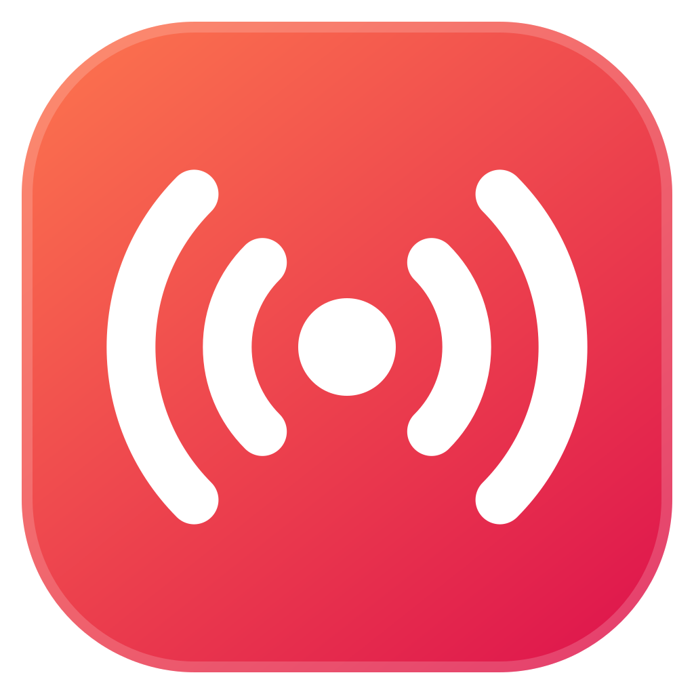
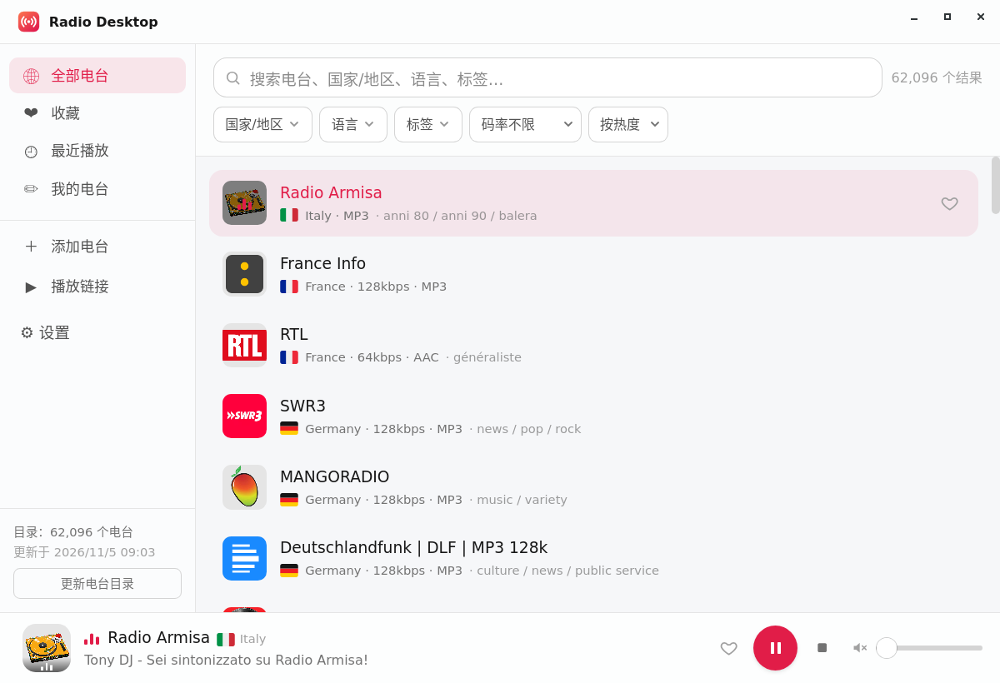
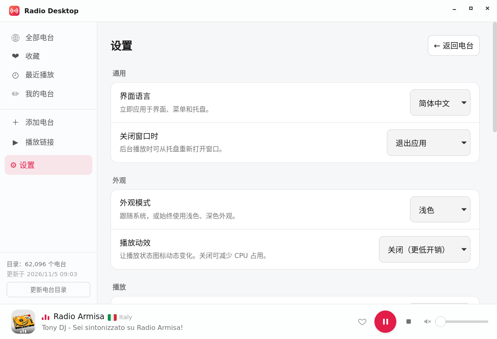
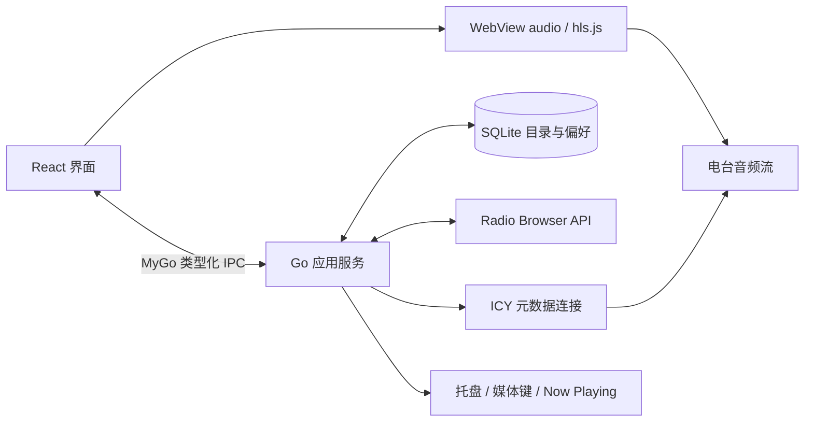

<p align="center"></p>
<h1 align="center">Radio Desktop</h1>
<p align="center">在桌面上，收听世界各地的网络电台。</p>
<p align="center">
  <a href="LICENSE"></a>
  
  
</p>
<p align="center"><a href="README.md">English</a> · 简体中文</p>

Radio Desktop 是 [radio-cli](https://github.com/hmgle/radio-cli) 的 GUI 姊妹项目，采用 Go、React 和 [MyGo](https://github.com/egoist/mygo)，使用系统 WebView 播放音频。日常收听无需安装外部播放器、mpv 或 FFmpeg。



## 功能

- **本地电台目录**：同步 [Radio Browser](https://www.radio-browser.info/) 目录到 SQLite，先获取热门电台，再后台同步完整目录。支持名称、国家/地区、语言、标签搜索，以及码率筛选和多种排序。
- **个人收藏**：收藏、最近播放、自定义电台及直接播放流链接。
- **曲目信息**：显示电台提供的 ICY 曲名、封面和电台详情。
- **桌面集成**：托盘、媒体播放/暂停键、Now Playing；可用性取决于系统与桌面环境。
- **收听体验**：音量记忆、淡入淡出、启动恢复、睡眠定时器。
- **个性设置**：中英文界面、浅色/深色/跟随系统主题、键盘导航与可关闭的播放动效。

MP3、AAC、HLS 的支持取决于系统 WebView 和编解码器。HLS 优先使用系统支持，否则尝试内置 hls.js。部分电台可能失效或有地区限制。

<details>
<summary>设置界面</summary>



截图来自 Linux 桌面应用，原生窗口控件因平台而异。见[截图说明](docs/images/README.md)。
</details>

## 安装与启动

从 [GitHub Releases](https://github.com/hmgle/radio-desktop/releases/latest) 下载对应平台的安装包。macOS 提供未签名的磁盘映像，Linux 提供 `.deb`，或 tarball 与单独的 `install.sh`，Windows x64 提供未签名的 `.exe` 安装包。源码构建方法如下。

预编译安装包支持 **Linux x86_64**、**macOS Apple Silicon（arm64）** 和 **Windows x64**，其他架构可从源码构建。Windows 运行 `radio-desktop-setup-<版本>-amd64.exe`，图形界面播放和安装仍需实机验证。

每个版本随附对应源码及 `SHA256SUMS`。将校验文件与需要的安装包下载到同一目录：Linux 可运行 `sha256sum --ignore-missing --check SHA256SUMS`；macOS 使用 `shasum -a 256 <文件>`；Windows 使用 `Get-FileHash <文件> -Algorithm SHA256`，后两者需与校验文件中的对应条目比较。目前通过下载、安装新版安装包更新，应用尚不支持自动检查或安装更新。

Linux 用户目录安装需同时下载 `install.sh` 和对应 tarball，审阅脚本后运行 `sh ./install.sh ./radio-desktop-0.2.1-linux-amd64.tar.gz`。Debian/Ubuntu 用户也可运行 `sudo apt install ./radio-desktop_0.2.1_amd64.deb`。

安装 **Go 1.27.3 或更新版本**及 **Bun 1.4.2**（与 CI 一致），在项目检出目录执行：

```sh
bun install --frozen-lockfile
bun run dev
```

Windows 需要 [Microsoft Edge WebView2 Runtime](https://developer.microsoft.com/microsoft-edge/webview2/)；若缺失，请安装 Evergreen Runtime。应用安装包不内置此运行库。

macOS 需要 Xcode Command Line Tools（`xcode-select --install`）。Linux 先安装运行库：

```sh
# Debian / Ubuntu
sudo apt install libwebkit2gtk-4.1-0 libgtk-3-0 libpulse0
# Fedora
sudo dnf install webkit2gtk4.1 gtk3 pulseaudio-libs
```

生成桌面安装包：

```sh
bun run build
```

产物位于 `build/<平台>-<架构>/`。macOS 生成 `.app` 和 `.dmg`，Linux 生成可执行文件、`.deb`、tarball 和单独的 `install.sh`，Windows 生成可执行文件和 NSIS `.exe` 安装包；Windows 未安装 NSIS 时，MyGo 会自动下载。建议在目标系统构建。详见[开发指南](docs/development.md)（英文）。

## 开始收听

1. 等待首次目录加载，或点击侧栏的「更新目录」。
2. 搜索、筛选并点击电台播放，点击爱心收藏。
3. 「播放链接」可以临时试听 MP3/AAC/HLS 直链，「添加电台」可长期保存。
4. 在「设置」中调整语言、主题、启动和关闭行为。默认关闭窗口后隐藏到托盘继续播放；通过托盘或应用菜单中的「退出」结束程序。

[用户指南](docs/user-guide.zh-CN.md)介绍快捷键、备份、网络行为与故障排查，也提供[英文版](docs/user-guide.md)。

## 架构



搜索、收藏、历史保存在本地。收听需要网络；目录电台成功起播时会向 Radio Browser 上报一次点击。电台和封面提供方会收到相应请求。详见[网络与本地数据](docs/user-guide.zh-CN.md#网络与本地数据)。

## 参与贡献

欢迎问题反馈、翻译和聚焦的 Pull Request。请先阅读[贡献指南](CONTRIBUTING.md)（英文）；历史变更见[更新日志](CHANGELOG.md)。

## 许可证与致谢

项目原创代码与文档采用 **GPL-3.0-only**，完整条款见 [LICENSE](LICENSE)。Copyright © 2026 hmgle and Radio Desktop contributors。

第三方组件与素材保留各自许可证，见 [THIRD_PARTY_NOTICES.md](THIRD_PARTY_NOTICES.md)。电台台标、曲目封面和广播内容属于各自权利人，不受应用许可证授权。

感谢 [Radio Browser](https://www.radio-browser.info/)、[MyGo](https://github.com/egoist/mygo)、[radio-cli](https://github.com/hmgle/radio-cli) 和 [mygo-cloudmusic](https://github.com/egoist/mygo-cloudmusic) 提供目录服务、框架与设计参考。
